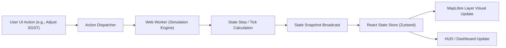

# India: Statecraft — Technical Architecture

## 1. System Overview & Technology Stack

**India: Statecraft** is built as an interactive, web-first strategy simulation game with high performance, modular architecture, and zero-compromise developer ergonomics.

| Component | Technology | Rationale |
| :--- | :--- | :--- |
| **Frontend Framework** | React 18+ & TypeScript | Component-driven UI, strong type-safety, rich ecosystem. |
| **Map Rendering** | MapLibre GL JS | Open-source WebGL map rendering, high frame rates with vector layers, dynamic styling for 12+ map modes without heavy game engine overhead. |
| **Monorepo / Workspace** | NPM / Turborepo Workspaces | Clean separation between web client, simulation engine, game data, and types. |
| **Simulation Engine** | Pure TypeScript / Web Workers | Decoupled from React UI. Runs in Web Worker for single-player, adaptable for server-side authoritative loops. |
| **State Management** | Zustand / Custom Event Bus | Lightweight, fast reactivity without Redux boilerplate. |
| **Persistence (Local)** | IndexedDB (idb-keyval / Dexie) | Robust client-side local save state for Guest Mode with auto-save and slot management. |
| **Backend & Cloud Auth** | Supabase (PostgreSQL + Auth) | Seamless Google OAuth, cloud save synchronization, row-level security (RLS). |
| **Hosting & Edge Delivery**| Cloudflare Pages | Global edge CDN, automated CI/CD directly from GitHub commits, zero server maintenance costs. |
| **Future Multiplayer** | Cloudflare Workers & Durable Objects | Authoritative game loops, stateful room sessions, low-latency edge coordination. |
| **Mobile Bridge (Future)** | Capacitor | Future native packaging for Android without rebuilding the web core. |

---

## 2. Monorepo Project Structure

```
india-statecraft/
├── apps/
│   ├── web/                     # React + Vite + MapLibre frontend application
│   │   ├── src/
│   │   │   ├── components/      # UI components (Dashboard, MapOverlay, HUD, StateDrawer)
│   │   │   ├── hooks/           # Custom React hooks (useSimulation, useMap, useAuth)
│   │   │   ├── map/             # MapLibre controller, layer managers, mode shaders/styles
│   │   │   ├── workers/         # Web Worker bridge for simulation ticks
│   │   │   └── App.tsx          # Root application entry
│   │   ├── public/              # Static assets, GeoJSON data, sprites
│   │   ├── vite.config.ts       # Vite build configuration
│   │   └── package.json
│   └── server/                  # Reserved for future multiplayer edge/backend services
│       └── README.md
├── packages/
│   ├── shared-types/            # Shared interfaces: State, Economy, MapMode, Tick events
│   │   └── src/index.ts
│   ├── game-data/               # Canonical 28 states, 8 UTs, starting data, baseline stats
│   │   └── src/index.ts
│   ├── map-data/                # Map layers metadata, color palettes, GeoJSON helpers
│   │   └── src/index.ts
│   └── simulation/              # Core headless deterministic simulation engine
│       ├── src/
│       │   ├── engine.ts        # Tick loop, event dispatcher
│       │   ├── economy.ts       # SGST, CapEx, debt, inflation, GDP value-added
│       │   ├── demographics.ts  # Population, migration, workforce
│       │   ├── hydrology.ts     # Rivers, dams, seasonal monsoons
│       │   └── politics.ts      # Election clock, approval rating, policy enactments
│       └── index.ts
├── docs/                        # Architecture and design documentation
│   ├── GAME_DESIGN.md
│   ├── TECHNICAL_ARCHITECTURE.md
│   ├── MAP_DATA_SPEC.md
│   └── SIMULATION_RULES.md
├── tests/                       # Automated tests (simulation logic, types, data integrity)
├── package.json                 # Monorepo root configuration
└── README.md                    # Project README and quickstart guide
```

---

## 3. Decoupled Simulation & Deterministic State Engine

### 3.1 Headless Design
To support single-player (client-side execution) and future multiplayer (server-side authoritative execution), the simulation engine (`packages/simulation`) is **completely isolated** from the DOM and React.
- **Input**: The simulation takes an initial `GameState` and applies user `PlayerAction` commands (e.g., `SetTaxRate`, `ConstructDam`, `ZoneIndustrialCorridor`).
- **Tick Function**: A pure or deterministic reducer `stepSimulation(state: GameState, dt: number): GameState`.
- **Worker Execution**: In single-player, the engine runs inside a dedicated `Web Worker` so that complex economic or demographic calculations across 28 states never stutter the 60fps MapLibre render thread.

### 3.2 Action Flow Architecture


---

## 4. Authentication & Data Persistence

### 4.1 Dual-Tier Mode: Guest vs. Cloud Sync
1. **Guest Mode (Default)**:
   - Zero friction. The player clicks "Start Game" without entering any credentials.
   - Game state is serialized to `IndexedDB` under a local save slot.
   - Autosave runs every 6 in-game months and on window blur/unload.
2. **Google OAuth (Supabase)**:
   - When a user chooses "Save to Cloud" or "Sign in with Google", Supabase Auth is invoked via PKCE flow.
   - **Migration Protocol**: If a guest player logs in mid-game, their active local save is securely migrated and linked to their Supabase user ID in PostgreSQL table `user_saves`.
   - Never store private API secrets (e.g. `service_role` key) in frontend client bundles. Only publish the public `anon` key.

---

## 5. Deployment & CI/CD Pipeline

- **Host**: Cloudflare Pages.
- **Build Output**: `apps/web/dist`
- **Build Command**: `npm run build`
- **Automation**: Git push to `main` triggers automated build, asset optimization, and edge deployment with preview URLs generated for branch pull requests.
